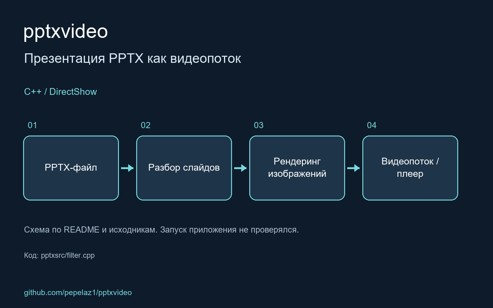

C++ DirectShow source filter which reads pptx files, converts them into images and outputs as video stream + player application using the filter

<!-- portfolio-visual:start -->
## Схема работы

Схема подготовлена по README и исходному коду. Запуск приложения не проверялся.
<!-- portfolio-visual:end -->
